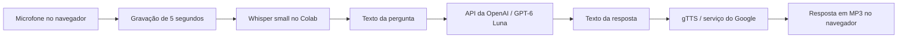

# Assistente de voz com Whisper e ChatGPT

Faça uma pergunta pelo microfone e receba uma resposta em texto e voz. Este projeto educacional conecta gravação no navegador, transcrição com Whisper, resposta pela API da OpenAI e síntese com gTTS em um notebook do **Google Colab**.

**Estado da versão:** as correções aprovadas foram implementadas e verificadas com testes locais, SDK real com transporte simulado e Chromium com microfone simulado. A execução completa no Colab com microfone físico, Whisper, OpenAI e gTTS reais ainda precisa ser validada. Não houve consumo da API durante os testes.

## Que problema resolve e para que pode ser usado

O projeto demonstra como transformar uma pergunta falada em uma resposta que também pode ser ouvida. Serve para aprender a integrar serviços de IA e explorar interfaces que reduzem a necessidade de digitar e ler.

- Demonstrações em aulas, apresentações técnicas e projetos de portfólio.
- Estudo das etapas de captura, transcrição, geração de texto e síntese de voz.
- Protótipos de interfaces conversacionais e de acessibilidade, que precisam ser avaliados com seus usuários antes do uso real.

É um protótipo de **uma pergunta independente por execução**. Não mantém histórico, não executa ações no computador e não oferece cadastro, atendimento multiusuário ou implantação como serviço.

## Como funciona



| Etapa | Tecnologia | Onde acontece |
| --- | --- | --- |
| Captura | JavaScript e MediaRecorder | No navegador; o arquivo é transferido ao Colab. |
| Transcrição | Whisper `small` e FFmpeg | No ambiente de execução Colab. Não utiliza a API de transcrição da OpenAI. |
| Resposta | SDK Python da OpenAI e `gpt-6-luna` | A transcrição é enviada à API como uma mensagem de usuário. |
| Voz | gTTS e IPython Audio | O serviço do Google gera MP3; o notebook exibe o reprodutor. |

## Requisitos

- Conta Google e acesso ao Google Colab.
- Navegador por HTTPS com suporte a `MediaRecorder`, microfone autorizado e saída de áudio.
- Internet para instalar pacotes, baixar o Whisper e acessar OpenAI e Google.
- FFmpeg no ambiente Colab. A célula de preparação verifica sua presença antes de instalar os pacotes.
- Chave da API da OpenAI com faturamento/créditos e acesso ao modelo `gpt-6-luna`, necessária somente para a etapa de resposta.

O notebook usa recursos próprios do Colab. Abrir o arquivo em um Jupyter comum não oferece a mesma captura do navegador. Os scripts de teste podem rodar localmente; a aplicação continua destinada ao Colab.

## Abrir e executar no Colab

1. No Colab, escolha **Arquivo → Fazer upload de notebook** e envie `Assistente_de_Voz_com_Whisper_e_ChatGPT.ipynb` desta versão.
2. Conecte uma sessão, preferencialmente nova. CPU funciona; GPU pode acelerar a transcrição.
3. Execute a célula de configuração, a de preparação e a de funções, nessa ordem. A preparação instala as versões especificadas e informa conflitos de dependências.
4. Execute **Gravar a pergunta**, autorize o microfone e fale durante cinco segundos. Confira o áudio gravado.
5. Execute **Transcrever com Whisper**. Aguarde o carregamento/download inicial e confira o texto reconhecido.
6. Antes de executar **Obter a resposta da OpenAI**, configure a chave conforme as instruções abaixo. **Essa etapa envia a pergunta e pode gerar cobrança.**
7. Execute **Gerar e ouvir a resposta**. Se o navegador bloquear autoplay, clique em reproduzir.

Para uma nova pergunta, repita as etapas de gravação, transcrição, resposta e voz. Se uma etapa falhar, ela invalida os resultados seguintes para evitar usar uma pergunta ou resposta antiga por engano.

Você também pode [abrir a versão corrigida no Colab](https://colab.research.google.com/github/jonatamoraes97/Assistente-de-Voz-Com-Whisper-e-ChatGPT/blob/codex/corrige-assistente-voz/Assistente_de_Voz_com_Whisper_e_ChatGPT.ipynb), diretamente da branch de revisão `codex/corrige-assistente-voz`. Após a incorporação do PR, a branch `main` também terá as correções.

Se você já tinha uma cópia aberta no Colab, abra novamente a versão do link acima para carregar o código atualizado. Uma cópia antiga não recebe as alterações do GitHub automaticamente. Confira `"openai_model": "gpt-6-luna"` na primeira célula de código e execute as células na ordem apresentada; autorize o acesso ao segredo se o Colab solicitar.

## Configurar a chave com segurança

No Colab, abra **Segredos** pelo ícone de chave, crie o segredo `OPENAI_API_KEY` e habilite o acesso deste notebook. O código também aceita uma variável de ambiente com esse nome, que tem prioridade quando está preenchida.

Não escreva a chave no notebook, não a imprima e não a inclua em capturas de tela ou commits. O código rejeita textos de exemplo, mantém a variável de ambiente intacta e mostra mensagens de falha sem repetir o valor recebido.

Uma assinatura do ChatGPT não substitui faturamento da API. O acesso ao GPT-6 Luna e os preços dependem da conta e da disponibilidade do modelo na OpenAI.

## Configurações

Edite o dicionário `SETTINGS` na primeira célula de código:

```python
SETTINGS = {
    "language": "pt",
    "record_seconds": 5,
    "whisper_model": "small",
    "openai_model": "gpt-6-luna",
}
```

Esses são os valores atuais aprovados para o projeto. O modelo de texto foi atualizado após um teste no Colab retornar `HTTP 404 / model_not_found` com o modelo anterior. Ao alterar a configuração, execute novamente a preparação e as funções antes das etapas de áudio. Duração deve ser positiva e finita; outros idiomas precisam de suporte tanto no Whisper quanto no gTTS. Trocar modelos pode alterar custos, desempenho e compatibilidade. A troca para `gpt-6-luna` foi aprovada pelo autor; o acesso ao novo modelo ainda depende da conta/projeto e precisa de validação real.

O perfil de `gpt-6-luna` envia `reasoning_effort="none"`, aprovado para priorizar rapidez em perguntas simples por voz. Esse parâmetro é aplicado apenas ao identificador exato `gpt-6-luna`; outros modelos escolhidos em `SETTINGS` são enviados sem esse parâmetro para evitar incompatibilidades. Não há troca automática de modelo em caso de falha.

A [documentação oficial do GPT-6 Luna](https://developers.openai.com/api/docs/models/gpt-6-luna) confirma o suporte a Chat Completions e ao esforço `none`. Essa compatibilidade não garante o acesso de uma conta específica. A síntese de voz continua a cargo do gTTS; o modelo de texto não recebe o áudio.

## Instalação e dependências

A preparação usa o mesmo Python do kernel e interrompe a execução se a instalação falhar:

| Pacote | Versão especificada | Uso |
| --- | --- | --- |
| `openai` | `2.54.0` | Cliente atual com `client.chat.completions.create`. |
| `openai-whisper` | `20250625` | Reconhecimento de fala no Colab. |
| `gTTS` | `2.5.4` | Síntese de voz. |

Essas são versões diretas, não um lock completo de todas as dependências transitivas. A instalação conjunta da aplicação e a inferência Whisper não foram verificadas nesta revisão; o ambiente de testes utiliza as dependências leves listadas em `requirements-test.txt`.

**Conflito conhecido do ambiente:** gTTS 2.5.4 exige `click<8.2`, enquanto algumas ferramentas pré-instaladas no Colab exigem versões maiores. A preparação executa `pip check` e mostra os conflitos. Isso não é resolvido atualizando indiscriminadamente outras ferramentas. Use uma sessão nova e confira os avisos. Se um conflito impedir a execução, será necessário avaliar uma solução de isolamento ou mudança do mecanismo de voz antes de alterar a arquitetura.

Se FFmpeg estiver ausente, escolha um ambiente que o ofereça ou instale-o na sessão antes de repetir a preparação. O notebook não executa instalação de pacotes do sistema automaticamente.

## Arquivos e dados

```text
.
├── Assistente_de_Voz_com_Whisper_e_ChatGPT.ipynb
├── README.md
├── requirements-test.txt
├── TEMP-openai-migration-ledger.md
├── tests/
│   ├── test_notebook.py
│   ├── recording.test.cjs
│   └── browser-recording.cjs
└── docs/
    ├── revisao-tecnica.md
    └── validacao/
        ├── resultados-original.json
        └── resultados-corrigido.json
```

A gravação é salva no diretório atual da sessão, com extensão correspondente ao MIME real: por exemplo, `request_audio.webm`, `.ogg` ou `.m4a`. O gTTS gera `response_audio.mp3`; o arquivo final só é substituído depois de uma escrita completa. Os arquivos de áudio da sessão não são apagados automaticamente. Uma nova execução bem-sucedida pode substituir os arquivos de mesmo nome.

O Whisper processa o áudio na infraestrutura do Colab. A transcrição vai à OpenAI e o texto da resposta vai ao serviço do Google usado pelo gTTS. O projeto não promete retenção zero nem processamento em uma região específica.

Antes de compartilhar o notebook, limpe as saídas e confira os arquivos da sessão: o reprodutor pode incorporar áudio ao `.ipynb` salvo. Esta versão foi entregue sem saídas ou gravações embutidas. Isso não apaga o áudio existente em commits antigos nem cópias já compartilhadas. Evite informações pessoais ou confidenciais em demonstrações.

## O que foi corrigido

- Substituição da interface removida `openai.ChatCompletion.create` pelo cliente atual, com pergunta independente; modelo padrão atualizado para GPT-6 Luna com aprovação do autor.
- Leitura segura da chave, sem substituí-la pelo texto `API KEY AQUI`.
- Propagação de falhas de gravação e liberação do microfone no sucesso e na falha.
- Correspondência entre extensão e formato de áudio.
- Validação de preparação, arquivo de entrada, transcrição, resposta completa e arquivo de saída.
- Limpeza do estado das etapas seguintes após uma nova tentativa, impedindo reaproveitar silenciosamente resultados antigos.
- Instalação organizada, verificação de FFmpeg e mensagens para falhas de autenticação, acesso, cota, conexão e síntese.
- Diagnóstico com HTTP e códigos de erro conhecidos, incluindo `model_not_found`, sem exibir mensagens brutas, credenciais ou códigos desconhecidos do servidor.
- Distinção entre cota/saldo insuficiente e limite temporário de requisições.
- Remoção das saídas antigas do notebook e criação de testes de regressão.

## Testes e limites da validação

Em Linux com Python 3.12 e Node.js, na raiz do projeto:

```bash
python3 -m venv .venv-test
.venv-test/bin/python -m pip install -r requirements-test.txt
.venv-test/bin/python -m unittest discover -s tests -v
node --test tests/recording.test.cjs
.venv-test/bin/python -m pip check
```

Os testes Python executam as células reais do notebook, usam o SDK real com `httpx.MockTransport` e impedem conexões de socket externas. Whisper e os serviços de voz são substituídos; há também um teste do gTTS real com stream de bytes simulado. Os testes Node exercitam o JavaScript extraído do próprio notebook.

Para o teste adicional em Chromium, instale Playwright em uma pasta local e tenha `chromium` e `ffprobe` disponíveis:

```bash
npm install --no-save --package-lock=false playwright@1.62.1
node tests/browser-recording.cjs
```

O teste usa `/usr/bin/chromium` por padrão; configure `CHROMIUM_PATH` se necessário. Ele abre apenas uma página em localhost, usa dispositivo de áudio simulado, valida o áudio com ffprobe e confere a liberação das trilhas e a permissão negada.

**Resultado:** 43 testes Python e 13 testes Node aprovados, além do teste Chromium. [Resultados e limitações](docs/revisao-tecnica.md). Ainda falta executar o fluxo no Colab com microfone físico, Whisper real, chave válida e serviços OpenAI/Google disponíveis. Os testes não verificam qualidade de transcrição, qualidade da resposta, voz, preço ou acesso real ao modelo.

## Solução de problemas

| Mensagem ou sintoma | Como agir |
| --- | --- |
| Execute configuração, preparação e funções | Execute as três primeiras células de código em ordem e depois repita a etapa que falhou. |
| Gravação negada ou sem áudio | Revise a permissão do navegador, o microfone selecionado e o acesso HTTPS ao Colab. Grave novamente. |
| FFmpeg ausente | Prepare o ambiente com FFmpeg antes da transcrição. |
| Nenhuma fala reconhecida | Confira o áudio e grave uma pergunta audível; a API não será chamada com texto vazio. |
| Falha na transcrição | Confira arquivo, FFmpeg, memória e conexão para o download do modelo. CPU pode demorar. |
| Chave ausente ou autenticação recusada | Confira o nome `OPENAI_API_KEY`, o acesso do notebook aos Segredos e a validade da chave. Não publique o valor. |
| `HTTP: 404 / model_not_found` | O modelo configurado não existe ou não está disponível para essa chave/projeto. Confira `SETTINGS["openai_model"]` e o acesso ao modelo no projeto OpenAI. O código não distingue essas duas causas sozinho. |
| Sem permissão ou solicitação recusada | Confira o HTTP e o código conhecido exibidos, o projeto OpenAI e o acesso ao modelo. Códigos desconhecidos são omitidos para proteger dados. |
| `HTTP: 429 / insufficient_quota` | Confira saldo/faturamento da API e limites; esperar entre tentativas não repõe créditos. |
| `HTTP: 429 / rate_limit_exceeded` | Aguarde antes de reenviar e reduza a frequência de chamadas. |
| Limite ou cota insuficiente | Confira faturamento e limites da API; evite repetir continuamente a chamada. |
| Resposta incompleta ou sem texto | Repita a etapa OpenAI antes de gerar voz. |
| Falha ao gerar voz | Confira a conexão com o serviço do Google; a resposta em texto continua disponível. |
| Áudio não reproduz automaticamente | Use o botão do reprodutor e confira a saída de áudio. |
| Conflitos de pacotes | Leia o resultado de `pip check` e a seção de dependências. |

## Referências e licença

- [Whisper oficial](https://github.com/openai/whisper)
- [SDK Python da OpenAI](https://github.com/openai/openai-python)
- [gTTS](https://gtts.readthedocs.io/)
- [MediaRecorder](https://developer.mozilla.org/en-US/docs/Web/API/MediaRecorder)

O repositório original não contém licença. A escolha de uma licença de uso, modificação e distribuição cabe ao autor; esta revisão não adicionou uma.
